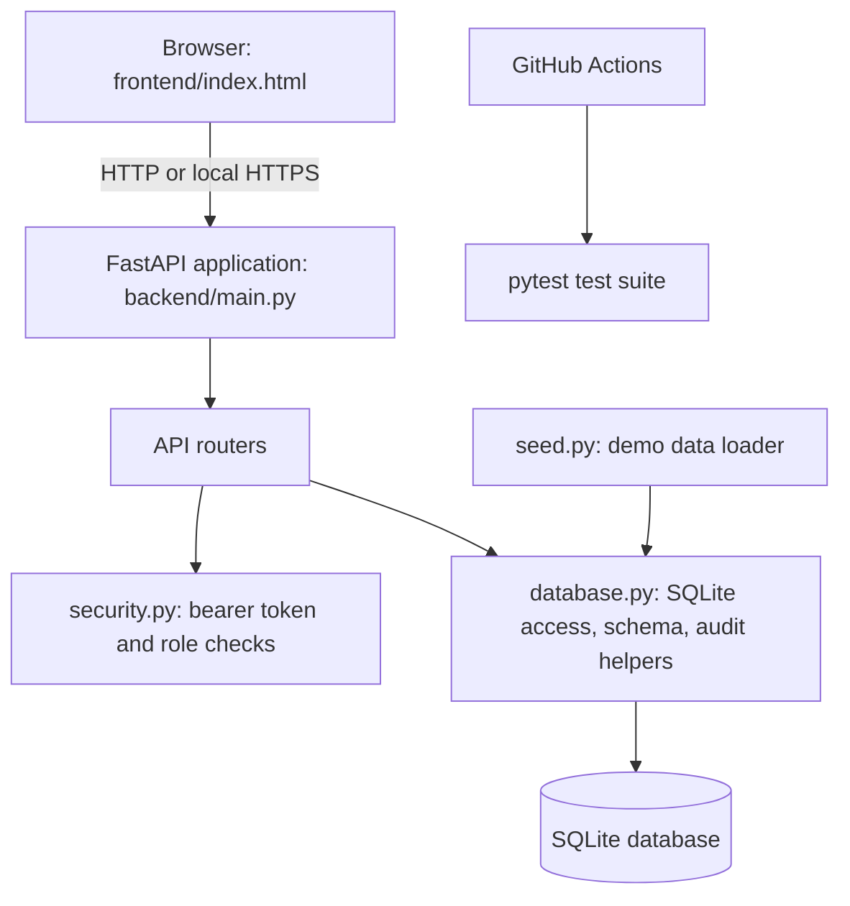

# Student Attendance Management System
## Architecture and Design Specification — As-Built

**Document purpose:** Record the architecture and design visible in the supplied repository snapshot for TASK-006.  
**Status:** As-built documentation draft for review  
**Supersedes:** Architecture and Design Specification v1.0 as the description of the implemented system; retain v1.0 as the original baseline.  
**Snapshot reviewed:** 30 October 2026  
**Repository:** `Student-Attendance-Management/student-attendance-management-system`

> This document describes the provided source snapshot. It does not claim that the snapshot is the latest deployed release. Items marked as gaps or unverified must not be represented as completed without supporting implementation or test evidence.

## 1. System overview

SAMS is a browser-based attendance application. A single HTML page is served by a Python FastAPI application. The API applies authentication, role checks, attendance rules, and report calculations, then reads or writes a SQLite database.

### Implemented technology

| Area | As-built design |
|---|---|
| Backend/API | Python, FastAPI, Uvicorn |
| User interface | Single-page HTML/CSS/JavaScript at `frontend/index.html`, served by FastAPI at `/` |
| Database | SQLite; default file `sams.db`, configurable with `SAMS_DB` |
| Authentication | Bearer tokens kept in process memory; roles are Admin, Faculty, and Student |
| Password storage | Per-password random salt with PBKDF2-HMAC-SHA256 (200,000 iterations) |
| Session timeout | Configurable by `SAMS_SESSION_TIMEOUT`; default 1,800 seconds |
| Local HTTPS | Optional `run_https.py` script using a generated self-signed development certificate |
| Automation | GitHub Actions workflow installs requirements and runs pytest on pushes to `main` and pull requests |

The architecture is layered within one application process; the supplied code does not implement separate microservices.

## 2. Architecture

### Component responsibilities

| Component | Responsibility |
|---|---|
| `backend/main.py` | Creates the FastAPI app, configures CORS, registers routers, initializes the database at startup, and serves the frontend. |
| `backend/config.py` | Reads database path and session timeout from environment variables. |
| `backend/security.py` | Hashes and checks passwords; authenticates bearer tokens; applies role checks and session expiry. |
| `backend/database.py` | Defines SQLite schema, opens connections with foreign keys enabled, initializes defaults, records audit events, and translates integrity errors. |
| `backend/routers/auth.py` | Login and logout endpoints. |
| `backend/routers/master_data.py` | Classes, subjects, students, faculty, and faculty assignments. |
| `backend/routers/attendance.py` | Session creation, roster retrieval, marking, correction, history, percentage, and faculty summary. |
| `backend/routers/reports.py` | Attendance reports, CSV export, and low-attendance results. |
| `backend/routers/admin.py` | Attendance rules and audit-log retrieval. |
| `frontend/index.html` | Role-aware login and Admin, Faculty, and Student screens using the API. |
| `seed.py` | Loads reproducible sample data if student data is not already present. |
| `run_https.py` | Starts local HTTPS on `127.0.0.1:8443` with a self-signed development certificate. |

## 3. Data design

The SQLite schema contains these entities and relationships:

- `users`: unique username, password hash, role, status, and optional reference to a student or faculty record.
- `students` and `faculty`: person profiles. Students may reference a class.
- `classes` and `subjects`: academic grouping and subject catalog.
- `assignments`: connects a faculty member, subject, and class; the combination is unique.
- `att_sessions`: one attendance session for an assignment, date, and period; that combination is unique.
- `records`: one Present/Absent value per student and session; `(session_id, student_id)` is unique.
- `rules`: configured attendance threshold and correction window; initialized to 75 percent and 48 hours.
- `audit`: actor, action, entity, entity identifier, and timestamp for recorded changes.

SQLite foreign-key enforcement is enabled for each connection. Database integrity constraints prevent duplicate assignments, duplicate sessions for the same assignment/date/period, duplicate student attendance in a session, and invalid attendance statuses.

## 4. Main API design

All endpoints are served by the FastAPI app. The interactive API description is available at `/docs` when the app is running.

| Method and path | Purpose / access visible in code |
|---|---|
| `POST /api/auth/login` | Validate credentials and issue a bearer token. |
| `POST /api/auth/logout` | Remove the caller's in-memory token. |
| `GET`, `POST /api/classes` | List or create classes; creation is Admin-only. |
| `GET`, `POST /api/subjects` | List or create subjects; creation is Admin-only. |
| `GET`, `POST /api/students` | Search/list students or create a student; creation is Admin-only. |
| `PATCH /api/students/{sid}/status` | Activate/deactivate a student and linked user; Admin-only. |
| `GET`, `POST /api/faculty` | List or create faculty; creation is Admin-only. |
| `POST /api/assignments` | Assign faculty to a class and subject; Admin-only. |
| `POST /api/attendance/sessions` | Create an attendance session for an assignment; Admin or assigned Faculty. |
| `GET /api/attendance/sessions/{sid}/students` | Retrieve active students for the session's class; Admin or assigned Faculty. |
| `POST /api/attendance/mark` | Save a list of Present/Absent records; Admin or assigned Faculty. Existing records return a duplicate conflict. |
| `PUT /api/attendance/correct` | Correct a record; Admin or assigned Faculty, with the correction window enforced for Faculty. |
| `GET /api/attendance/percentage` | Return attended count, conducted count, and percentage. Students are limited to their own record. |
| `GET /api/attendance/history` | Return attendance history. Students are limited to their own record. |
| `GET /api/attendance/summary` | Return assignment/session summaries for Admin or Faculty; Faculty is limited to their assignments. |
| `GET /api/attendance/report` | Return filtered report rows for Admin or Faculty; CSV is available with `export=csv`. |
| `GET /api/attendance/low` | Return active students below the configured threshold for Admin or Faculty. |
| `GET`, `PUT /api/rules` | Read rules as Admin/Faculty; update as Admin. |
| `GET /api/audit` | Return recent audit entries; Admin-only. |

### Calculation and correction rules

Attendance percentage is calculated centrally as `Present records / recorded attendance records * 100`, rounded to two decimal places. If no attendance records exist, the percentage is 0. The low-attendance endpoint flags students whose percentage is strictly below the configured threshold. Faculty corrections are denied after the configured correction window; Admin corrections are not subject to that check in the supplied code.

## 5. Security and deployment design

- Passwords are stored as salted PBKDF2-HMAC-SHA256 hashes, not as plaintext.
- API dependencies reject unauthenticated requests and enforce roles. Faculty access to assignment-specific attendance is checked against the faculty reference ID.
- Tokens are stored in a process-local Python dictionary and expire after the configured inactivity timeout. A server restart clears active tokens.
- Important attendance and administrative changes are written to the `audit` table.
- SQL statements use bound parameters for user-supplied values.
- The application currently sets CORS `allow_origins=["*"]`; deployment-specific origins are not restricted in this snapshot.
- The default administrator password is `admin123` unless `SAMS_ADMIN_PASSWORD` is set. This is a demo default and must be overridden for any non-demo deployment.
- `run_https.py` creates a self-signed local certificate. The README recommends terminating production TLS at a reverse proxy with a real certificate. Production HTTPS configuration is not included in the supplied source.
- Uvicorn's documented normal run command is local development configuration. Production hosting, backups, monitoring, and multi-worker session behavior are not specified in this source snapshot.

## 6. Implemented scope and deviations

| Original design / requirement | Evidence in supplied implementation | As-built status / documentation treatment |
|---|---|---|
| Python/Java/Node backend was to be selected | FastAPI/Python modules and `requirements.txt` | Implemented as Python + FastAPI. |
| MySQL or another relational DB was proposed | SQLite schema in `backend/database.py` | Implemented as SQLite; document SQLite-specific limits and deployment assumptions. |
| Layered architecture | Routers call security/database helpers in one FastAPI app | Implemented as a modular layered monolith, not microservices. |
| Notifications/alerts | `/api/attendance/low` returns a list below threshold | Low-attendance identification exists; email/push notifications are not present in supplied code. |
| Report export as CSV/PDF | `export=csv` in reports router | CSV is implemented; PDF export was not found. |
| Full record management | Create/list endpoints and student status patch are present | Update operations for existing student/faculty/class/subject profiles were not found; confirm against any code outside this snapshot before claiming complete CRUD. |
| HTTPS/TLS | Development script creates a self-signed certificate | Local HTTPS support exists; production TLS deployment is not demonstrated. |
| 100 concurrent users and 99% availability | Test-results PDF records only a 5-request concurrency smoke check; no monthly uptime evidence is included | These targets are unverified. Do not state that they passed. |
| Mobile/responsive UX | Single-page HTML exists | No mobile viewport evidence was supplied. Mark unverified unless separate test evidence exists. |

The previous SAD's technology stack table, API payload examples, component descriptions, and “Open Issues & Next Steps” must be revised to match these facts. The former API example for marking attendance does not match the implemented request, which accepts `sessionId` and a `records` array.

## 7. Open limitations in this snapshot

1. Authentication tokens are process-local, so they are not shared across multiple workers and are lost when the process restarts.
2. CORS allows all origins in the supplied app setup.
3. A demo administrator password is used unless overridden by environment configuration.
4. Email/push alerts and PDF report export are not implemented in the provided code.
5. Several master-data edit operations were not found.
6. Production TLS, production hosting, backup/recovery, and measured availability are not demonstrated.
7. The regression/security report notes pending HTTPS deployment testing and limits on its smoke/load checks.

## 8. Traceability and references

- Functional endpoints and schema are implemented in `backend/routers/`, `backend/database.py`, `backend/security.py`, and `frontend/index.html`.
- Runtime setup is described in `README.md`, `requirements.txt`, `run_https.py`, and `seed.py`.
- Automated test entry point: `tests/test_flow.py`; CI workflow: `.github/workflows/ci.yml`.
- Supporting project requirements and test plan: `Student_Attendance_Management_System_SRS.pdf` and `Student-Attendance-Management_STP.pdf`.
- Recorded regression/security results: `TASK-005_Regression_Security_Test_Cases.pdf`.

## 9. Review record

This draft was compared with the supplied source files and project documents. The code snapshot and recorded test report were inspected; tests were not rerun and a live deployment was not independently checked. The document should be considered ready for the Product Owner's review, not as evidence of approval by the project guide or other team members.

